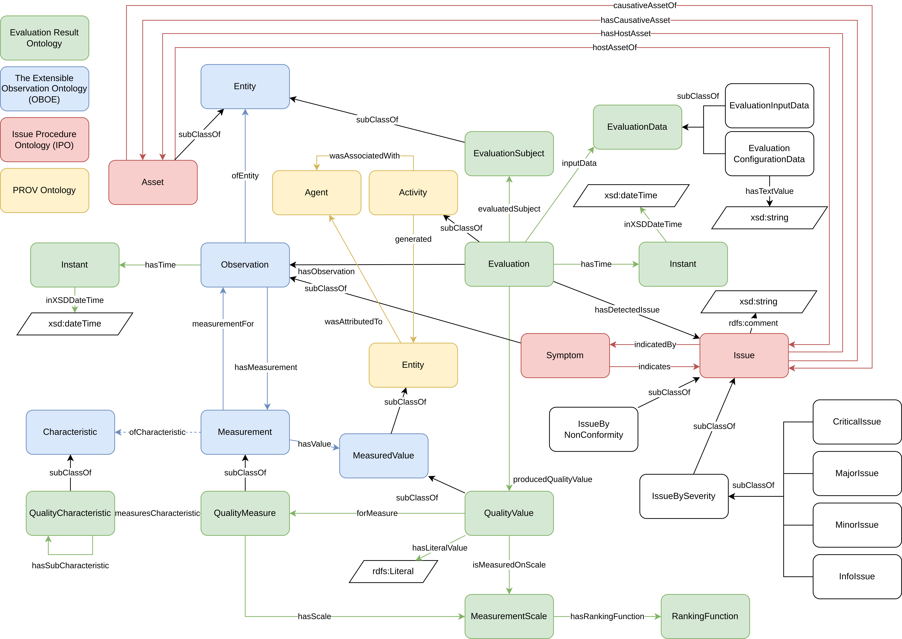
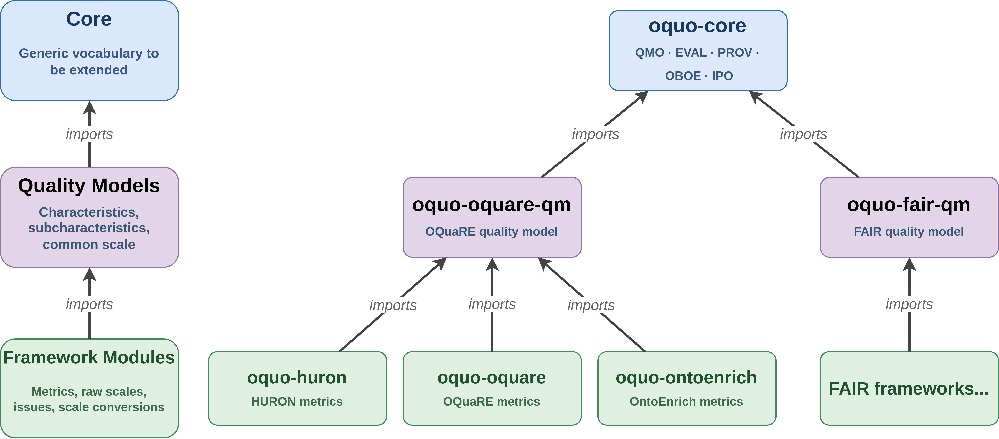

# Ontology QUality Ontology (OQUO)
The Ontology QUality Ontology (OQUO - [https://purl.org/oquo-core](https://purl.org/oquo-core)) lets you publish ontology evaluation results as linked data and compare or combine results from different evaluation frameworks. OQUO is a modular ontology that contains the semantic definitions to represent quality models based on metrics, characteristics and subcharacteristics; in addition to the entities needed to represent ontology evaluations.

The core module, oquo-core, contains the common entities needed to represent quality models and evaluations. Quality models and evaluation frameworks are integrated in modules that import it, such as the quality models [oquo-oquare-qm](https://purl.org/oquo-oquare-qm) and [oquo-fair-qm](https://purl.org/oquo-fair-qm), and the frameworks [oquo-huron](https://purl.org/oquo-huron), [oquo-oquare](https://purl.org/oquo-oquare) and [oquo-ontoenrich](https://purl.org/oquo-ontoenrich), each with its own namespace.

The module oquo-core is the result of reusing and aligning 5 different ontologies:

  - The Quality Model Ontology - [http://purl.org/net/QualityModel](http://purl.org/net/QualityModel)
  - The Evaluation Result Ontology - [http://purl.org/net/EvaluationResult](http://purl.org/net/EvaluationResult)
  - The Extensible Observation Ontology (OBOE) - [http://ecoinformatics.org/oboe/oboe.1.2/](http://ecoinformatics.org/oboe/oboe.1.2/)
  - The Issue Procedure Ontology (IPO) - [http://purl.org/ipo/core](http://purl.org/ipo/core)
  - The PROV Ontology (PROV-O), the W3C recommendation for provenance - [http://www.w3.org/ns/prov#](https://www.w3.org/TR/prov-o/)



The OQUO model can be used for defining and integrating quality models that combine metrics from different quality evaluation frameworks. We provide an example of how to use [OQUO for that purpose in QASAR, a tool for ontology quality assurance](./oquo-qasar/README.md).

## How to use OQUO

OQUO is used in three layers, each one an ontology that imports the one below:



1. **The core** ([oquo-core](https://purl.org/oquo-core)) provides the generic vocabulary: quality characteristics and measures, scales, scale conversions, issues, evaluations and their provenance.
2. **A quality model module** extends the core with a quality model: the characteristics to be assessed and the scale on which they are assessed, which is shared by all the frameworks that use the model. The repository includes two:
   - [oquo-oquare-qm](https://purl.org/oquo-oquare-qm), the OQuaRE quality model for ontologies, based on SQuaRE (ISO/IEC 25000), with an ordinal scale of five categories (`oquo-oquare-qm:OquareFiveCategoriesScale`).
   - [oquo-fair-qm](https://purl.org/oquo-fair-qm), the FAIR Guiding Principles as a quality model, with a percentage scale of degree of compliance (`oquo-fair-qm:PercentageScale`, from 0 to 100).
3. **A framework module** extends a quality model with the metrics of an evaluation framework or tool, and states how they relate to the characteristics and the scale of the model. For example, [oquo-huron](https://purl.org/oquo-huron), [oquo-oquare](https://purl.org/oquo-oquare) and [oquo-ontoenrich](https://purl.org/oquo-ontoenrich) extend oquo-oquare-qm. Several frameworks can extend the same quality model, so their results can be compared and combined on its scale.

Evaluation results are then described with the classes and individuals of the framework module, for example with the [tools](#tools-to-implement-oquo) below.

### What a quality model module contains

| Element | How it is represented | Example (oquo-oquare-qm) |
|---|---|---|
| Characteristics and subcharacteristics | Subclasses of `qm:QualityCharacteristic`, related to their subcharacteristics with restrictions on `qm:hasSubCharacteristic` | `oquo-oquare-qm:MaintainabilityCharacteristic` |
| Scale of the quality model | An individual of an `om:` scale class (e.g. `om:Ordinal_scale`, `om:Ratio_scale`), with its ranking function (`qm:hasRankigFunction`) and, for ordinal and nominal scales, its categories (`om:element`, ranked with `om:rank`) | `oquo-oquare-qm:OquareFiveCategoriesScale`, with the categories `OquareCategory1` to `OquareCategory5` |
| Metadata | The annotations described in [Metadata conventions](#metadata-conventions), such as the publication of the quality model (`dc:source`) | DOI of the OQuaRE paper |

A quality model module does not contain metrics: these depend on the framework that computes them.

### What a framework module contains

| Element | How it is represented | Example (oquo-huron) |
|---|---|---|
| Metrics | Subclasses of `qm:QualityMeasure` (e.g. `qm:DerivedMeasure`), with their raw scale (`qm:hasScale value <raw scale>`) and the characteristics of the quality model they measure (`oquo:measuresCharacteristicPositively` or `oquo:measuresCharacteristicNegatively some <characteristic>`) | `oquo-huron:NamesPerClassMetric` |
| Raw scales | One individual per metric, of type `oquo:RawScale` and of an `om:` scale class, with its ranking function. It is the scale on which the framework gives the values of the metric | `oquo-huron:NamesPerClassMetricScale` |
| Issues | Subclasses of `oquo:IssueByNonConformity` (or of a severity, such as `oquo:MajorIssue`), for the problems that the framework reports | `oquo-huron:ClassWithNoNameIssue` |
| Scale conversions | Individuals of one of the nine conversion classes (`oquo:CardinalToOrdinalScaleConversion`, `oquo:OrdinalToOrdinalScaleConversion`…), from the raw scale of a metric (`oquo:hasInputScale`) to the scale of the quality model (`oquo:hasOutputScale`), with a point mapping for each interval or category (`oquo:hasScalePointMapping`). They can be created with [oquo-scale-conversion-creator](#adding-scale-conversions-to-oquo-modules) | Conversion of `NamesPerClassMetricScale` to `OquareFiveCategoriesScale` |
| Software agent | An individual of `prov:SoftwareAgent` that represents the software of the framework, used as the agent of its evaluations (see [Provenance](#provenance)) | `oquo-huron:huron-software-agent` |
| Metadata | The annotations described in [Metadata conventions](#metadata-conventions), on the module, the metrics and the software agent | DOI of the HURON paper |

The scale conversions are what harmonises the results: the raw value of each metric is converted to the scale of the quality model, where the results of different metrics and frameworks can be compared and aggregated by characteristic.

## Provenance

The provenance of evaluation results is described with [PROV-O](https://www.w3.org/TR/prov-o/), with which the OQUO core is aligned:

| OQUO class | PROV-O class |
|---|---|
| `eval:Evaluation` | subclass of `prov:Activity` |
| `oboe:MeasuredValue`, and so `eval:QualityValue` | subclass of `prov:Entity` |
| `eval:EvaluationData` (input and configuration data) | subclass of `prov:Entity` |

The agents that run evaluations are `prov:Agent`: a tool (`prov:SoftwareAgent`), a person (`prov:Person`) or an organization (`prov:Organization`). The core declares the PROV-O properties that relate them, with the domains and ranges of PROV-O: `prov:generated` and its inverse `prov:wasGeneratedBy`, `prov:wasAssociatedWith`, `prov:wasAttributedTo` and `prov:used`, together with their superproperties `prov:wasInfluencedBy` and `prov:influenced`.

Every evaluation is linked to the quality value it generated and, when known, to the agent that ran it:

```turtle
<evaluation>
        a                       eval:Evaluation ;
        eval:producedQualityValue  <qualityValue> ;
        prov:generated          <qualityValue> ;
        prov:wasAssociatedWith  <agent> .

<qualityValue>
        a                       eval:QualityValue ;
        prov:wasGeneratedBy     <evaluation> ;
        prov:wasAttributedTo    <agent> .

<agent>  a  prov:SoftwareAgent .
```

`eval:producedQualityValue` is a subproperty of `prov:generated`, and `eval:obtainedFrom` of `prov:wasGeneratedBy`. Both are stated in the data, so that they can be used without a reasoner. An evaluation has a single `eval:producedQualityValue`, the value it measured, but it can generate further values, such as those obtained by converting it to other scales (see below).

The software that computes the metrics of a framework is described once, as a `prov:SoftwareAgent`, in the OQUO module of that framework, for example `oquo-huron:huron-software-agent`, `oquo-oquare:oquare-software-agent` or `oquo-ontoenrich:ontoenrich-software-agent`. Evaluation results only need to reference its IRI.

The version of a software agent changes from one evaluation to another, so it is not stated on the agent itself. When it is known, a separate agent represents that specific version, and is linked to the agent of the software in general:

```turtle
<agentVersion>
        a                       prov:SoftwareAgent ;
        schema:softwareVersion  "1.2.0" ;
        dcterms:isVersionOf     oquo-huron:huron-software-agent .
```

When a quality value is converted to another scale, using a scale conversion defined in an OQUO module, the new quality value is measured on the output scale of the conversion, shares the measure, evaluation and agent of the original one, and is linked to it with `prov:wasDerivedFrom`. When the output scale is ordinal or nominal, its literal value is the code of the category on the scale (e.g. its `om:rank`), and it is linked to the category itself with `obo:IAO_0000136` (*is about*):

```turtle
<convertedQualityValue>
        a                       eval:QualityValue ;
        eval:hasLiteralValue    1 ;
        eval:isMeasuredOnScale  oquo-oquare-qm:OquareFiveCategoriesScale ;
        obo:IAO_0000136         oquo-oquare-qm:OquareCategory1 ;
        eval:obtainedFrom       <evaluation> ;
        prov:wasGeneratedBy     <evaluation> ;
        prov:wasAttributedTo    <agent> ;
        prov:wasDerivedFrom     <qualityValue> .
```

The time of an evaluation is given by `time:hasTime` and a `time:Instant`, as in the Evaluation Result Ontology, rather than by `prov:startedAtTime` and `prov:endedAtTime`.

[oquo-instance-creator-endpoint](https://github.com/tecnomod-um/oquo-instance-creator-endpoint) generates this provenance from the agent given in each request, and the converted quality values from the scale conversions of the module given in the request.

Prefixes:

```turtle
@prefix oquo:    <https://purl.org/oquo#> .
@prefix eval:    <http://purl.org/net/EvaluationResult#> .
@prefix oboe:    <http://ecoinformatics.org/oboe/oboe.1.2/oboe-core.owl#> .
@prefix om:      <http://www.wurvoc.org/vocabularies/om-1.8/> .
@prefix obo:     <http://purl.obolibrary.org/obo/> .
@prefix prov:    <http://www.w3.org/ns/prov#> .
@prefix time:    <http://www.w3.org/2006/time#> .
@prefix schema:  <http://schema.org/> .
@prefix dcterms: <http://purl.org/dc/terms/> .
@prefix qm:      <http://purl.org/net/QualityModel#> .
@prefix oquo-oquare-qm: <https://purl.org/oquo-oquare-qm#> .
@prefix oquo-fair-qm: <https://purl.org/oquo-fair-qm#> .
@prefix oquo-huron: <https://purl.org/oquo-huron#> .
@prefix oquo-oquare: <https://purl.org/oquo-oquare#> .
@prefix oquo-ontoenrich: <https://purl.org/oquo-ontoenrich#> .
```

These prefixes are also used in the rest of this document.

## Tools to implement OQUO

The following tools help to produce OQUO-compliant data and to extend OQUO with new modules.

### Creating OQUO observations

OQUO represents each quality measurement as an observation that links the evaluated entity, the metric, the scale, the measured value and the time of the evaluation. Two tools generate this RDF so that it does not have to be written by hand:

- **[oquo-instance-creator](https://github.com/tecnomod-um/oquo-instance-creator)**: Java library, built on [Apache Jena](https://jena.apache.org/), that generates OQUO instances (observations, measurements, quality values, evaluations and time instants), together with their [provenance](#provenance), from the results of quality metrics. It can also add the OQUO module that describes the results, with its imports, and apply the scale conversions defined in it. Use it to integrate OQUO output directly into Java applications. Compatible with Java 8 and later.
- **[oquo-instance-creator-endpoint](https://github.com/tecnomod-um/oquo-instance-creator-endpoint)**: REST service, built on Spring Boot and on the library above, that exposes the same functionality to any language. Its `POST /toOquoObservation` method receives a JSON list of observations (entity, metric, scale, ranking function, value and timestamp), and optionally the agent that ran the evaluation, and returns the corresponding OQUO-compliant RDF. Its `POST /toOquoModel` method also receives the IRI of the OQUO module that describes the results (e.g. `https://purl.org/oquo-huron`), and returns, together with that RDF, the module and its imports, and the quality values obtained by applying the scale conversions defined in the module. Requires Java 17 or later.

### Adding scale conversions to OQUO modules

- **[oquo-scale-conversion-creator](https://github.com/tecnomod-um/oquo-scale-conversion-creator)**: command-line Java tool, built on the [OWL API](https://github.com/owlcs/owlapi), that adds scale conversions to OQUO-based modules, such as [oquo-huron](https://purl.org/oquo-huron), from a TSV file. Each row maps the raw values of a metric to the five categories of the OQuaRE scale (`oquo-oquare-qm:OquareFiveCategoriesScale`), that belongs to the [oquare quality model oquo module (oquo-oquare-qm)](./ontology/quality_models/oquo-oquare-qm.owl). For ratio input scales, each category is given as an interval of raw values, and the tool creates an `oquo:CardinalToOrdinalScaleConversion`. For ordinal input scales, each category is given as an input scale item, and the tool creates an `oquo:OrdinalToOrdinalScaleConversion`. In both cases it also creates the corresponding point mappings. Rows are validated before the ontology is modified, and the `--overwrite-scales` option replaces any existing conversion between the same input and output scales. Optionally, the tool can also create missing metrics and input scales. Requires Java 17 or later.

### Validating OQUO evaluation results

- **[SHACL shapes](./SHACL)**: shapes for checking that evaluation results described with OQUO, such as those generated by the tools above, are complete and well formed.


## Metadata conventions

OQUO declares a set of annotation properties for recording the provenance of any of its elements (ontologies, characteristics, metrics, scales, issues…) and tracing them to their sources: publications, authors, web pages and code. They are reused from standard vocabularies and, being annotations, they do not affect reasoning. Ontologies that extend OQUO use them as they need.

PROV-O, used for the [provenance of evaluation results](#provenance), does not provide properties for bibliographic and descriptive metadata, such as the DOI of a publication, a web page or a code repository. For creators and sources, the annotation properties below are standard Dublin Core properties.

| Metadata | Annotation property | Value |
|---|---|---|
| Resource the element is derived from, such as a publication | `dc:source` | IRI, e.g. a DOI (`https://doi.org/10.xxxx/yyyy`) |
| Author of the element | `dc:creator` | IRI of the author (e.g. their ORCID) or their name |
| Source of the definition of the element (`obo:IAO_0000115`) | `obo:IAO_0000119` | Text, e.g. a citation, or IRI, e.g. a DOI |
| Web page of the element | `foaf:homepage` | IRI |
| Source code repository of the element | `schema:codeRepository` | IRI, e.g. a GitHub repository |
| Any other related resource | `rdfs:seeAlso` | IRI |

Prefixes:

```turtle
@prefix dc:     <http://purl.org/dc/elements/1.1/> .
@prefix obo:    <http://purl.obolibrary.org/obo/> .
@prefix foaf:   <http://xmlns.com/foaf/0.1/> .
@prefix schema: <http://schema.org/> .
@prefix rdfs:   <http://www.w3.org/2000/01/rdf-schema#> .
```

The example below also uses:

```turtle
@prefix owl:        <http://www.w3.org/2002/07/owl#> .
@prefix prov:       <http://www.w3.org/ns/prov#> .
@prefix oquo-huron: <https://purl.org/oquo-huron#> .
```

Use IRIs as values whenever possible (DOIs, ORCIDs, URLs), so the metadata can be resolved and processed by machines.

The provenance of evaluation results (who or what ran an evaluation, which data it used, what it generated) is described with the PROV-O classes and properties of the core, not with these annotations (see [Provenance](#provenance)).

Example:

```turtle
<https://purl.org/oquo-huron> a owl:Ontology ;
    dc:creator <https://orcid.org/0000-0003-0201-3115> ;
    schema:codeRepository <https://github.com/tecnomod-um/huron> ;
    dc:source <https://doi.org/10.1109/ACCESS.2023.3316512> ;
    rdfs:seeAlso <https://semantics.inf.um.es/huron/> .

oquo-huron:NamesPerClassMetric
    dc:source <https://doi.org/10.1109/ACCESS.2023.3316512> .

oquo-huron:huron-software-agent
    a prov:SoftwareAgent ;
    dc:source <https://doi.org/10.1109/ACCESS.2023.3316512> ;
    schema:codeRepository <https://github.com/tecnomod-um/huron> ;
    foaf:homepage <https://semantics.inf.um.es/huron/> .
```


## How to cite

If you use OQUO, please cite:

> Abad-Navarro, F., Duque-Ramos, A., Quesada-Martínez, M., Juanes-Cortés, B. and Fernández-Breis, J. T. (2026). OQUO: Towards a Unified Semantic Model of Ontology Quality. In *Proceedings of the 18th International Joint Conference on Knowledge Discovery, Knowledge Engineering and Knowledge Management (IC3K 2026) - Volume 2: KEOD*, pages 1037-1044. SciTePress. https://doi.org/10.5220/0015451300004985

```bibtex
@inproceedings{abadnavarro2026oquo,
  author    = {Abad-Navarro, Francisco and Duque-Ramos, Astrid and Quesada-Mart{\'i}nez, Manuel and Juanes-Cort{\'e}s, Bel{\'e}n and Fern{\'a}ndez-Breis, Jesualdo Tom{\'a}s},
  title     = {{OQUO}: Towards a Unified Semantic Model of Ontology Quality},
  booktitle = {Proceedings of the 18th International Joint Conference on Knowledge Discovery, Knowledge Engineering and Knowledge Management (IC3K 2026) - Volume 2: KEOD},
  pages     = {1037--1044},
  year      = {2026},
  publisher = {SciTePress},
  organization = {INSTICC},
  doi       = {10.5220/0015451300004985},
  isbn      = {978-989-758-868-6},
  issn      = {2184-3228}
}
```